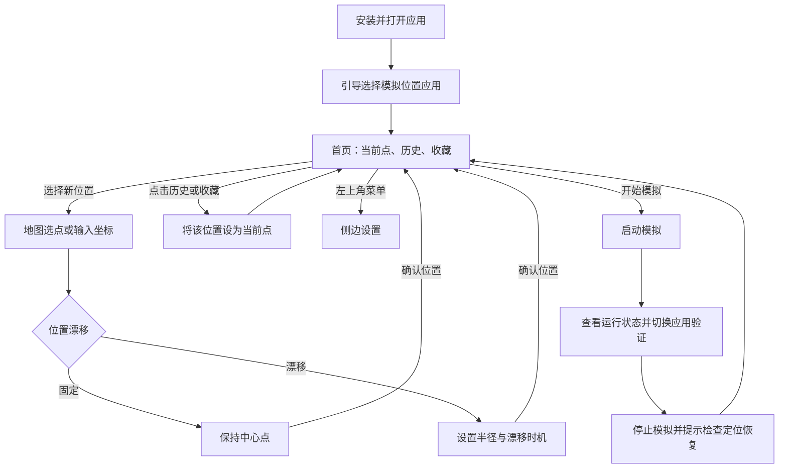

# Android 定位模拟工具：功能需求文档

> 日期：2026-11-10。本文记录首版需求和验收条件。构建与当前支持范围见 [README](../README.md)。

## 1. 目标与范围

用户在 Android 手机上选择地图坐标，启动固定定位，或使模拟位置围绕该坐标在指定半径内持续漂移，用于位置相关功能的测试。应用通过 Android 的模拟位置机制提供位置；其他应用是否采纳以及是否识别为模拟位置，取决于系统和目标应用，不能保证所有应用生效。

首版面向个人或小范围测试，使用本地设置和 APK 安装；不要求 Root、电脑常驻、账号或自建后端。iOS 暂不开发。模拟范围是圆的**半径**，单位为米。

| 优先级 | 功能 |
| --- | --- |
| P0：首版 | 首页当前选点与启动入口、选点历史、置顶与收藏、侧边设置、地图选点和坐标输入、固定定位与随机漂移、开始与停止、权限引导和异常提示 |
| P1：后续候选 | 收藏分组、地图样式切换、快速设置入口 |
| 不在首版 | iOS 全局模拟、隐藏模拟位置标记、绕过其他应用限制、路线导航、摇杆、账号同步、后台静默启动 |

地图服务和使用地区仍需确认。首版可以使用经纬度作为地点名称，地图能提供名称时同时展示。

## 2. 目标用户和主流程

个人测试者希望安装后快速选点，设置固定位置或在周围漂移，切换到其他应用验证。

### 页面规划

| 页面 | 主要内容 | 关键操作 |
| --- | --- | --- |
| 首页 | 当前点和模式摘要、开始模拟、历史与收藏列表 | 选择新位置、复用历史点、置顶、收藏、打开侧边设置 |
| 地图选点 | 选点标记、手动经纬度、漂移开关及范围预览 | 点击地图或输入坐标、拖动和缩放、调整漂移参数、确认位置或返回 |
| 模拟运行页 | 当前中心、最近输出位置、模拟状态 | 停止模拟后回到首页，可重新选点或调整漂移参数 |
| 设置侧栏 | 外观、模拟位置设置、通知、历史清理、关于 | 从首页左上角打开，点击遮罩或返回关闭 |
| 设置引导与错误 | 模拟位置授权说明或当前错误 | 打开系统设置、返回后重新检查 |

## 3. 功能需求与验收

以下记录当前实现的默认值与验收边界，产品行为调整时同步本文和架构文档。

### FR-01 首次使用和权限引导

- 用户故事：作为首次使用者，我希望知道怎样在系统设置中选择本应用作为模拟位置应用。
- 显示简要说明，并提供打开开发者选项的入口；无法直接打开时提供手动路径提示，不自动更改系统设置。
- 启动时检查必要条件；没有被选择为模拟位置应用或操作被系统拒绝时，保持未运行，展示具体问题及重新检查入口。
- 显示地图和手动选点不以读取真实位置为前提。只有使用确需真实位置或对应前台服务的功能时才说明并请求所需权限；通知及前台服务权限按目标版本处理。
- **验收**：未授权时点击开始不显示运行成功；选择本应用后返回并重新检查，允许继续；系统设置入口不可用时仍可看到手动引导。

### FR-02 地图选点与坐标输入

- 用户故事：作为用户，我希望通过地图或直接输入坐标指定模拟中心。
- 点首页地图预览编辑已有位置，或从「添加位置」新建。点击地图设置选点，也可搜索地点或输入十进制度经纬度。拖动、快速甩动、双指缩放和加减按钮只调整视野。编辑保存更新原记录，新建确认新增一条记录。
- 输入纬度范围为 `[-90, 90]`，经度范围为 `[-180, 180]`，无效、空值或非数字不可确认；输入坐标明确标注为 WGS-84。
- 在侧边设置的「地图来源」或地图页右上角切换高德地图、百度地图、Google 地图、OpenFreeMap、OpenStreetMap 或 VersaTiles，Google 位于第三项。切换时保留选点和视野。底图需要联网，高德和百度选点得到近似 WGS‑84 坐标。
- 点击「定位到当前位置」时申请前台定位权限，支持精确和大致位置。定位成功后更新选点并移动地图视野，等待用户确认。拒绝权限、系统定位关闭或获取超时时提示原因，用户仍可在地图点选或手动输入坐标。
- **验收** 点击地图后记录显示的经纬度，拖动及缩放时坐标保持原值。确认后首页更新当前点并新增或刷新历史，取消时首页和历史保持原样。输入 `91` 纬度或空值时展示错误。地图加载失败时仍可手动输入。

### FR-03 模拟模式和参数

- 用户故事：作为用户，我希望自行选择是否启用位置漂移；开启时，以选定位置为中心设置漂移半径。
- 位置漂移关闭时为固定定位：地图仅显示选中的中心点，不显示漂移范围圆，也不显示半径设置；模拟位置持续使用中心点。
- 位置漂移开启时，地图显示以选定位置为圆心的漂移范围圆，并提供半径设置；每次更新生成的新位置均不超出该范围。
- 默认关闭漂移。开启后半径默认 50 m，可手动输入整数 1–5000 m。漂移开关、半径和时机跟单个位置保存。新选点默认仅在开始模拟时随机选择一次位置。也可按 1–9999 秒、分钟、小时或天重复漂移，或设置每天的 24 小时时刻。旧配置保留已保存的秒级间隔。关闭漂移时隐藏半径和时机。
- 保存上次确认的坐标和参数到本机；重新打开后可恢复设置，但不自动恢复模拟运行。运行时修改中心、模式或参数需先停止再调整，避免运行状态与界面不一致。
- **验收**：关闭漂移时地图只显示中心点、没有范围圆或半径输入，输出坐标始终为中心点；开启漂移并设置半径 100 m 时，地图显示以中心点为圆心的范围圆，1000 次生成位置经距离计算均不超过 100 m（允许 0.1 m 数值误差）；越界参数不能开始；重启 App 后设置保留且状态为未运行。

### FR-04 漂移行为

- 启动时在圆内随机选点；后续定时漂移每次移动距离不得大于 `min(半径 × 10%, 10 m)`。手动刷新在整个圆内重新选点，不受定时漂移步长限制，但不能越出设定半径。
- 漂移时机控制何时改变坐标。模拟服务会定期发送当前坐标。每天定时按手机当地时间计算，在模拟运行期间生效，系统休眠或后台调度可能延迟执行。
- **验收**：固定随机种子下，连续 1000 个点均在范围内，且相邻点距离不超过上述步长上限加 0.1 m；固定模式输出始终为中心点。

### FR-05 启动、运行、停止

- 用户点击开始后依次检查参数、系统设置与必要条件，成功注册并输出首个模拟位置后显示“运行中”；失败时给出原因和下一步操作，不显示成功。
- 运行期间展示模式、中心、最近一次成功输出的位置、状态和停止入口；前台服务通知提供停止操作。
- 定时漂移运行时展示下次执行的当地时间和倒计时，与服务共用同一个截止时间；切回首页或手动刷新不重置计划。仅启动时漂移显示已完成启动漂移及可手动刷新的说明，固定定位不显示漂移倒计时。
- 用户点击停止后，停止更新并尝试移除本应用创建的测试位置提供器；清理失败要提示，不能声称已恢复真实位置。恢复真实定位依赖系统与目标应用，应提示用户验证，必要时在系统设置中取消模拟应用选择或重启设备。
- 服务异常中断、用户强制停止或权限被撤销后，不保证收到清理回调；下次打开时显示未运行/中断并提供排查提示，不自动启动。
- **验收**：成功启动后通知可见且运行状态与服务一致；在 App 或通知点击停止后无新模拟输出；撤销模拟应用授权后失败被展示；杀进程及强制停止的实际行为在目标机型单独记录。

### FR-06 错误与降级

| 场景 | 预期 |
| --- | --- |
| 地图网络或 SDK 不可用 | 显示加载失败；允许手动输入坐标 |
| 未选本应用为模拟位置应用 | 提示打开系统设置；不能进入运行中 |
| 前台服务或首次注入失败 | 显示错误并停止已启动的资源 |
| 运行时注入失败 | 停止更新并提示中断，尝试清理 |
| 本地数据读取失败 | 保留已有记录，显示重试入口；恢复后界面继续更新，运行中仍可停止模拟 |
| 目标应用不接受模拟位置 | 提示兼容性限制，不承诺一定生效 |

### FR-07 首页、历史位置与收藏

- 首页顶部显示当前点、经纬度、固定或漂移状态，以及「添加位置」「开始模拟」。无当前点时开始按钮不可用。漂移预览显示完整范围，运行时用蓝针和灰针区分当前与上一次位置，并提供原位转圈的手动刷新。图例用同样大小的蓝点「本次」和灰点「上次」。最近一次模拟点在停止和重开应用后仍保留。
- 新建或导入位置时新增独立记录；编辑已有位置保留原记录标识。复用列表中的位置时更新最近选择时间，保留置顶与收藏状态。历史仅记录明确选中的中心点。
- 列表默认显示「全部」，可切换为「收藏」。置顶项在当前列表排在前面，置顶组和普通组内分别按最近选择时间倒序。收藏与置顶独立，可同时使用。
- 点历史条目设为当前点，恢复该位置自己的漂移配置。浅黄色实心星标表示收藏，无黑色描边；左滑覆盖显示置顶与删除。长按菜单可编辑名称和经纬度，或复制、分享位置。长按经纬度可复制坐标，回到应用时识别剪贴板里的 VLoc 分享文本，确认导入后才保存。
- 独立历史管理页按日期分组，显示收藏和置顶标记，可组合搜索、日期与「全部位置／收藏位置／置顶位置」筛选。切换筛选清空勾选；全选、批量操作和所选备份只使用当前筛选结果。普通和多选模式保持标题、统计行和记录起始位置不变。
- 历史页「⋯」菜单可通过系统文件选择器备份全部或选中的位置，保留稳定标识、名称、坐标、最近选择时间、收藏、置顶、漂移开关、半径及漂移时机。从文件恢复前显示新增和更新数量，用户确认后一次性合并：相同标识覆盖，不同标识新增，其他历史保留。当前选中的记录若被覆盖则同步其保存配置，正在运行的会话保持原快照；恢复不自动选择新位置或启动模拟。
- **备份验收**：完整往返还原上述字段；重复恢复不产生重复项；取消恢复不更改数据；任一记录非法、标识重复、版本不支持、文件超过 5 MB 或保存失败时不写入部分历史。备份不包含最近模拟点、外观或地图来源设置。
- **验收**：确认 A、B 后依次显示 B、A。置顶 A 后 A 排首位。收藏 B 后，切到「收藏」只显示 B。重新选择 A 后，历史仍只有两条并保留 A 的置顶状态。关闭再打开应用，记录、置顶和收藏保留，模拟处于未运行状态。

### FR-08 侧边设置

| 设置项 | 行为 |
| --- | --- |
| 外观 | 跟随系统（默认）、浅色、深色，选择后立即应用 |
| 模拟位置设置 | 展示设置步骤，提供系统开发者选项入口和手动路径 |
| 地图来源 | 选择并保存应用内底图，六种来源均可在应用内选点 |
| 通知设置 | 打开系统的应用通知设置 |
| 历史位置 | 收起侧栏并进入独立历史管理页，支持搜索、日期筛选、收藏、置顶、编辑、分享和批量操作 |
| 关于 | 显示应用版本、地图数据来源和模拟定位说明 |

- 首页左上角菜单打开侧栏，点击遮罩或返回键关闭。漂移参数在地图选点页设置。
- **验收**：打开和关闭侧栏后保持首页当前选点和列表筛选。清理取消时数据无变化。确认清理后，普通历史移除，置顶、收藏和当前选点保留。

## 4. 非功能需求与验收方法

| 项目 | 首版要求与验证 |
| --- | --- |
| 兼容性 | 最低 Android 版本暂建议 API 26，最终结合地图 SDK 和目标设备确认；至少覆盖一个较低支持版本、一个 Android 14+ 真机，并记录机型和系统版本。 |
| 包体 | 希望尽量小，暂不承诺具体 MB；记录包含地图 SDK 的 Release APK 大小及设备 ABI，使用 APK Analyzer 定位主要占用，再决定优化目标。 |
| 隐私 | 当前选点、历史、收藏与设置保存在本机。地图服务请求涉及第三方网络，接入前核查数据、权限、密钥和隐私要求。 |
| 可靠性 | 在选定真机完成前台、切后台及锁屏测试；各场景的测试时长、系统策略和结果要记录，不能承诺后台永不被杀。 |
| 使用体验 | 支持系统字体缩放、浅色/深色主题和基础无障碍标签；错误提示可理解且有可执行的下一步。 |
| 分发 | 提供签名 Release APK；同签名更新验证通过；应用商店审核及设备对外部分发的限制另行确认。 |

## 5. 开发前需确认或验证

1. **主要使用地区和地图服务**：国内或海外，是否需要地点搜索，地图 SDK 的覆盖、费用、包体和坐标转换能力。
2. **目标 Android 设备**：品牌、系统版本和最低版本；以实机确定模拟提供器及后台表现。
3. **参数取值**：确认半径、间隔和默认值；上面的取值只是建议。
4. **界面方向**：简约浅色、深色科技感或参考某款产品；需要时先做 Figma 高保真原型。
5. **发行方式**：仅个人安装，还是未来上架商店；影响签名、权限披露及发布流程。

## 6. 依据

- [Android 开发者选项：选择模拟位置应用](https://developer.android.com/studio/debug/dev-options)
- [Android LocationManager 测试位置提供器](https://developer.android.com/reference/android/location/LocationManager)
- [Android 位置对象的模拟标记](https://developer.android.com/reference/android/location/Location)
- [前台服务的后台启动限制](https://developer.android.com/develop/background-work/services/fgs/restrictions-bg-start)

关联文档：[架构设计文档](架构设计文档.md)、[项目规范文档](项目规范文档.md)。
