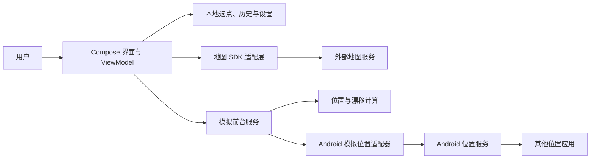
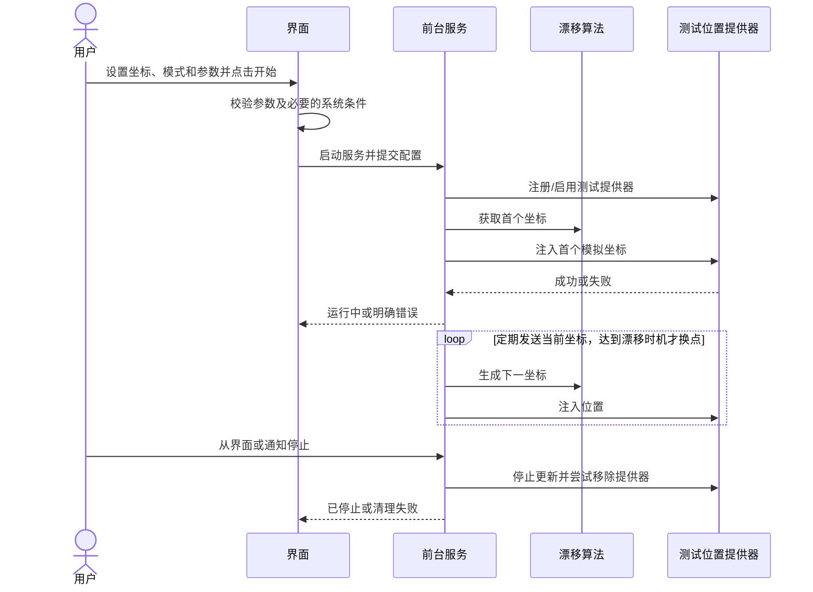

# Android 定位模拟工具：架构设计文档

> 日期：2026-11-10。本文记录首版 Android 架构和验证计划。

## 1. 架构目标与边界

实现本地地图选点、固定位置和圆内漂移；系统模拟位置能力由 Android 适配层完成。首版不建设服务端，不引入账号，不开发 iOS。外部地图服务是可选网络依赖，不承诺离线地图。

系统提供器生成的位置带有模拟标记；目标应用可选择不接受或采用其他位置来源。无法保证全系统应用均使用模拟坐标，也不设计隐藏标记能力。

## 2. 技术选型

| 层面 | 首版建议 | 取舍 |
| --- | --- | --- |
| 平台与语言 | Android / Kotlin | 直接调用系统接口；iOS 不共享实现 |
| UI | Jetpack Compose + Material 3，主题定制 | 原生 UI、官方组件；外观和具体组件库可在原型后调整 |
| 状态 | 单 Activity + Compose，ViewModel + StateFlow | 首页持有已确认选点和列表，地图页维护本次编辑草稿 |
| 地图 | osmdroid 渲染 OpenStreetMap，MapLibre Native 渲染 OpenFreeMap 和 VersaTiles | 高德、百度与 Google 使用 WebView 加载随包的 Leaflet，各来源按需在应用内初始化 |
| 本地存储 | DataStore Preferences 存储结构化快照 | 以一次更新保存当前配置及对应历史，首页使用惰性列表 |
| 模拟位置 | `LocationManager` 测试提供器，由用户在系统中选择本应用 | 系统会标记模拟位置；提供器兼容范围必须真机验证 |
| 持续执行 | 用户在前台明确启动的前台服务 + 通知 | 受系统版本、前台服务类型、权限和厂商后台策略限制 |
| 打包 | Gradle，签名 Release APK；开启 R8/资源压缩前验证地图 SDK | 可测量包体，但不提前承诺大小 |

最低版本为 API 26，编译与目标版本为 API 36。Gradle、Kotlin、Compose 等版本以项目的 Gradle Wrapper 和版本目录为准。

## 3. 系统和依赖

建议先按包划分职责，单个 Android app 模块即可；只有在出现真实复用需求时再拆 Gradle 模块。

| 包/职责 | 输入 | 输出与责任 |
| --- | --- | --- |
| `ui` | 用户操作、运行状态 | 首页和历史列表、地图选点、侧边设置、权限引导 |
| `map` | WGS-84 选点、地图视野 | 渲染底图、选点、完整漂移范围与实际漂移点，处理点击选点和来源切换 |
| `simulation` | 中心、模式、半径、漂移时机 | 可测试的漂移算法、时机计算、参数校验与会话状态 |
| `platform` | 模拟位置、服务命令 | 前台服务、通知、测试提供器和系统错误转换 |
| `data` | 当前配置、用户确认的中心点及设置 | 本地读写，维护历史去重、置顶、收藏和清理 |

界面不负责服务生命周期，模拟算法不依赖 Compose、地图 SDK 或 Android 的全局状态。

## 4. 关键流程和状态

编辑当前点时，用已确认配置初始化草稿，保存后更新原记录。添加选点与粘贴导入确认后各新增一条记录。选择历史或收藏点时，更新当前中心和该记录的最近选择时间，恢复该位置自己的漂移开关、半径与时机。模拟服务启动时接收已确认配置的快照。

侧边设置作为首页的覆盖层。点「历史位置」收起侧栏，进入独立历史管理页，支持搜索、日期筛选和批量处理。外观等全局设置独立于模拟会话。

状态：`Idle`（未运行）→ `Starting`（准备中）→ `Running`（首点注入成功）→ `Stopping` → `Idle`。启动或运行失败进入 `Error`，停止更新、尝试清理，用户可重新检查后再次开始。进程死亡后内存状态丢失，不能仅凭本地标记认定服务仍在运行；重新打开时按中断/未运行提示，不自动启动。

服务拥有唯一活动会话；重复开始应拒绝或返回现有状态。首版运行时不允许修改参数；停止后修改并重新启动。通知停止和界面停止走同一清理路径。强制停止或系统终止不保证执行清理，状态和恢复效果需真机验证。

## 5. 数据与算法

### 5.1 核心数据

| 数据 | 字段及约束 |
| --- | --- |
| `Coordinate` | 纬度、经度，单位十进制度，内部 WGS-84；分别为 `[-90,90]`、`[-180,180]` |
| `SimulationConfig` | 中心、模式、半径、漂移时机。半径 1–5000 m，默认 50 m。时机支持仅启动时、固定间隔和每天当地时间。 |
| `HistoryEntry` | WGS-84 坐标、可选名称、最近选择时间、置顶、收藏及该位置的漂移配置 |
| `AppPreferences` | 外观偏好，默认跟随系统 |
| `SimulationState` | Idle/Starting/Running/Stopping/Error、最近成功位置与错误原因；不把状态持久化当作服务运行证明 |

历史使用稳定标识。旧记录沿用原坐标键，新记录使用独立标识。编辑名称或坐标保留标识、置顶及收藏。首页列表先按置顶标记排序，再按最近选择时间倒序；历史管理页按日期分组。当前配置独立保存，删除历史条目后仍可继续使用。最近一次成功注入的模拟点保存在本地，用于停止或重开后显示灰针；运行中还在内存保留本次和上次坐标，不保存完整轨迹。

数据读取失败时保留原文件并显示重试入口。重试重新订阅存储，恢复后继续接收后续修改；不通过清空历史来隐藏读取错误。

服务运行期间若界面被销毁，服务持有运行配置，恢复界面时读取服务的实际状态。

### 5.2 漂移计算

固定模式重复输出中心点。漂移模式启动时在圆内随机选点；后续定时漂移生成受最大步长限制的随机移动，候选点越出圆时重新生成，使输出点到中心的球面距离始终不超过设定半径。定时漂移最大步长为 `min(半径 × 0.1, 10 m)`；手动刷新在整个圆内重新选点。重试次数有上限。测试中注入随机源和时钟，生产中无需额外配置。

界面将位置漂移作为可选开关：关闭时地图只展示中心点，不显示漂移范围或半径设置；开启时才显示以所选位置为圆心的范围和半径设置。开关状态与会话配置一致，运行期间需先停止再修改。

使用以米为单位的地理距离计算并处理经度跨越 ±180° 与高纬度情况。选点标记和范围图层使用地理坐标，视野拖动及缩放不会写入选点。外部链接按服务商文档传递 WGS-84 坐标。

## 6. 系统接口与异常

位置提供器名称和适配策略需通过目标设备与独立接收应用验证，不能假定单一提供器覆盖所有定位 SDK。`Location` 对象必须包含系统要求的完整字段，包括 provider、精度、时间和 elapsed realtime；接口调用应处理 `SecurityException`、非法参数与提供器不存在等错误。来源：[LocationManager](https://developer.android.com/reference/android/location/LocationManager)、[Location](https://developer.android.com/reference/android/location/Location)。

开始时从可见界面启动前台服务。具体服务类型、声明和运行时权限随 Android 版本及最终实现检查；如果读取真实位置或使用 `location` 类型，必须满足对应的定位权限和服务前置条件。通知权限和系统通知展示规则按目标版本验证。不要为了模拟功能默认请求后台真实位置；如确需读取另行说明。参见 [启动前台服务](https://developer.android.com/develop/background-work/services/fgs/launch) 和 [后台启动限制](https://developer.android.com/develop/background-work/services/fgs/restrictions-bg-start)。

地图访问失败应不阻塞手动输入。启动失败时清理已创建的资源；运行中失败则停止循环、更新状态并尝试清理。日志只记录错误类别、设备与版本等必要信息，不默认输出坐标、密钥或位置历史。

## 7. 设计决策与权衡

1. **原生 Android 优先**：满足首版系统 API 需求并控制依赖；代价是未来 iOS 需另行设计。
2. **单模块、职责分包**：项目小，先避免多模块构建和抽象成本；服务和算法边界仍需清晰。
3. **固定位置与漂移使用同一会话模型**：便于复用启动、停止和异常处理；具体漂移算法保持独立可测试。
4. **地图来源可切换**。OpenStreetMap 使用 HTTPS 瓦片、有限磁盘缓存和可见署名。OpenFreeMap 和 VersaTiles 共用 MapLibre Native 渲染器，主题变化时地图对象和 Compose 容器同步重建。高德、百度和 Google 通过随包的 WebView 适配使用 HTTPS 瓦片。安装包按 ARM 架构拆分。
5. **不自动恢复模拟**：重启或异常中断后由用户明确重新启动，降低状态不明和权限失效风险。

## 8. 验证计划

- 纯逻辑测试：参数边界、固定点、1000 次漂移范围和步长、经度跨界及高纬度、固定种子重复性。
- 首页与存储：确认和取消选点、显式添加、原记录编辑、分享与导入、置顶排序、收藏筛选、重启保留。
- 真机集成：模拟应用未授权/授权/运行中撤销；首点输出；通知和界面停止；重新进入；服务异常与强制停止；系统是否恢复真实定位。
- 兼容验证：独立接收应用测试系统位置来源，并分别记录目标地图或定位应用的结果；覆盖至少一台 Android 14+ 真机与一台较低支持版本设备，按实际可获得设备扩展厂商矩阵。
- Release 验证：可安装、签名更新、锁屏/切后台观察、权限说明、APK 大小与地图 SDK 占用。

## 9. Figma 原型

原型覆盖首页历史和收藏、侧边设置、地图选点、漂移关闭与开启、模拟运行及权限引导。首轮使用浅色主题。系统模拟位置能力由 Android 真机验证。[Figma 原型](https://www.figma.com/design/3giF3uo75nPmyTMeKj0PHO?node-id=2-2)

关联文档：[功能需求文档](功能需求文档.md)、[项目规范文档](项目规范文档.md)。
